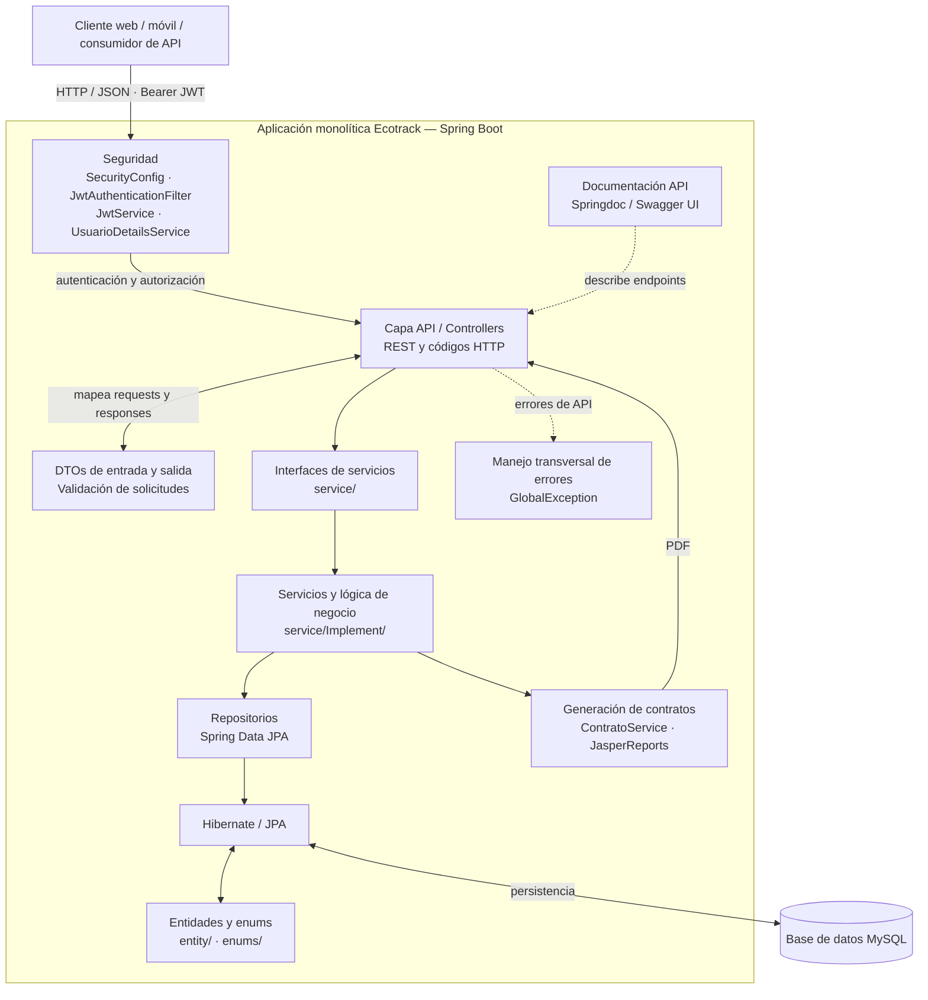

# Arquitectura del sistema Ecotrack

## Estilo arquitectónico

Ecotrack está implementado como un **monolito por capas**: una aplicación Spring
Boot contiene los módulos funcionales y se ejecuta como un único backend. No está
dividido en microservicios. La interfaz web, si se utiliza, consume la API desde
fuera de este repositorio.

## Vista general

## Capas y responsabilidades

| Capa | Ubicación principal | Responsabilidad |
|---|---|---|
| API | `controller/` | Expone endpoints REST, recibe solicitudes y devuelve respuestas HTTP. |
| Contratos | `dto/request/`, `dto/response/` | Define los datos de entrada y salida; las solicitudes pueden validarse antes de ejecutar la lógica. |
| Servicios | `service/` y `service/Implement/` | Implementa reglas de negocio, coordina operaciones y llama a los repositorios. |
| Persistencia | `repository/` | Interfaces Spring Data JPA para consultas y operaciones sobre las entidades. |
| Modelo | `entity/`, `enums/` | Entidades persistentes y valores enumerados del dominio. |
| Base de datos | MySQL | Almacenamiento relacional usado por la aplicación principal. |

Las dependencias del flujo principal apuntan hacia abajo: **Controller → Service →
Repository → JPA/Hibernate → MySQL**. Los servicios trabajan con el modelo
persistente y los controladores usan DTOs para el contrato HTTP.

## Módulos funcionales

- **Acceso y usuarios:** registro, inicio de sesión y gestión de usuarios.
- **Solicitudes y asignaciones:** solicitudes, asignación de coordinadores,
  asignaciones iniciales y totales, y recomendaciones.
- **Programación y operación:** programación de servicios, reserva de unidades,
  vehículos, colas, cargas y artículos recuperados.
- **Pagos y atención:** pagos iniciales y totales, medios de pago y notificaciones.
- **Contratos:** generación de documentos PDF desde plantillas JasperReports.

Los controladores y servicios están separados por funcionalidad, pero forman
parte del mismo proceso y despliegue monolítico.

## Seguridad y solicitudes

1. Los clientes envían solicitudes HTTP a la API; las rutas de inicio de sesión y
   registro están configuradas como públicas.
2. `JwtAuthenticationFilter` procesa el token Bearer cuando está presente. La
   aplicación usa sesiones sin estado y `SecurityConfig` define las reglas de
   acceso por endpoint y rol.
3. En el inicio de sesión, Spring Security consulta los datos de usuario y
   verifica la contraseña con `BCryptPasswordEncoder`; `JwtService` emite el token.
4. Los controladores delegan las operaciones a los servicios. Las respuestas
   siguen el formato de `ApiResponse`, salvo respuestas específicas como el PDF.
5. `GlobalException` centraliza algunas respuestas de error de la API; OpenAPI y
   Swagger UI documentan los endpoints.

## Persistencia y configuración

- La aplicación principal está configurada para conectarse a **MySQL**.
- Hibernate está configurado con `ddl-auto=update` en la configuración principal.
- El perfil de integración usa **H2 en memoria**, con `create-drop`, para aislar
  las pruebas de la base de desarrollo.
- La configuración de conexión y seguridad debe proporcionarse según el entorno;
  no forma parte del diagrama ni de este documento.

## Pruebas

Las pruebas unitarias usan JUnit y Mockito. Las pruebas de integración levantan
el contexto Spring y la API contra H2. Failsafe ejecuta las clases `*IT`, y JaCoCo
genera los reportes de cobertura.
