# DER — Entidades y campos

Diagrama con los campos persistidos de las entidades JPA y sus relaciones.
Los nombres de campos corresponden a las columnas de base de datos. Los comentarios
indican propiedades como nulabilidad, claves únicas, precisión y nombres Java cuando
difieren del nombre de la columna.

```mermaid
erDiagram
    UsuarioEntity {
        int id_usuario PK "Java: idUsuario; autogenerado"
        String nombre "NOT NULL"
        String apellido "NOT NULL"
        String correo UK "NOT NULL"
        String celular "nullable"
        String username UK "NOT NULL"
        String password "NOT NULL"
        String dni UK "NOT NULL"
        boolean estado "NOT NULL"
        Rol rol "Enum como String; NOT NULL"
        SituacionUsuario situacion "Enum como String; NOT NULL"
    }

    VehiculoEntity {
        int id_vehiculo PK "Java: idVehiculo; autogenerado"
        LocalDateTime fecha_registro "NOT NULL"
        String placa UK "NOT NULL"
        String marca "NOT NULL"
        String modelo "NOT NULL"
        BigDecimal capacidad_libras "DECIMAL(10,2); NOT NULL"
        TipoVehiculo tipo "Enum como String; NOT NULL"
        boolean estado "NOT NULL"
        SituacionVehiculo situacion "Enum como String; NOT NULL"
    }

    SolicitudEntity {
        int id_solicitud PK "Java: idSolicitud; autogenerado"
        LocalDateTime fecha_registro "NOT NULL"
        String titulo "NOT NULL"
        String descripcion "TEXT; NOT NULL"
        String ubicacion "NOT NULL"
        LocalDateTime fecha_finalizacion "Java: fechaFinalizacion; nullable"
        int id_usuario FK "Java: usuario; NOT NULL"
        EstadoSolicitud estado "Enum como String; NOT NULL"
    }

    ProgramacionEntity {
        int id_programacion PK "Java: idProgramacion; autogenerado"
        LocalDateTime fecha_registro "NOT NULL"
        LocalDateTime fecha_ejecucion "Java: fechaEjecucion; nullable"
        LocalDateTime fecha_finalizacion "Java: fechaFinalizacion; nullable"
        int id_solicitud FK "Java: solicitud; NOT NULL"
        int id_coordinador FK "Java: coordinador; NOT NULL"
        int id_jefe_unidad FK "Java: jefeUnidad; NOT NULL"
        EstadoProgramacion estado "Enum como String; NOT NULL"
    }

    ReservaUnidadEntity {
        int id_reserva PK "Java: idReserva; autogenerado"
        LocalDateTime fecha_reserva "Java: fechaReserva; NOT NULL"
        LocalDateTime fecha_expiracion "Java: fechaExpiracion; NOT NULL"
        int id_programacion FK "Java: programacion; NOT NULL"
        int id_transportista FK "Java: transportista; NOT NULL; unico"
        int id_vehiculo FK "Java: vehiculo; NOT NULL; unico"
        int id_usuario_reserva FK "Java: usuarioReserva; NOT NULL"
    }

    AsignacionCoordinadorEntity {
        int id_asignacion_coordinador PK "Java: idAsignacionCoordinador; autogenerado"
        int id_solicitud FK "Java: solicitud; NOT NULL; unico"
        int id_coordinador FK "Java: coordinador; NOT NULL; unico"
    }

    AsignacionInicialEntity {
        int id_asignacion_inicial PK "Java: idAsignacionInicial; autogenerado"
        BigDecimal monto_asignado_inicial "DECIMAL(12,2); NOT NULL"
        String razon "NOT NULL"
        LocalDateTime fecha_registro "NOT NULL"
        int id_solicitud FK "Java: solicitud; NOT NULL; unico"
        int id_coordinador FK "Java: coordinador; NOT NULL"
    }

    AsignacionTotalEntity {
        int id_asignacion_total PK "Java: idAsignacionTotal; autogenerado"
        BigDecimal monto_asignado_total "Java: montoAsignadoTotal; NOT NULL"
        String razon "NOT NULL"
        BigDecimal monto_descontado "Java: montoDescontado; NOT NULL"
        BigDecimal monto_por_cobrar "Java: montoPorCobrar; NOT NULL"
        LocalDateTime fecha_registro "NOT NULL"
        int id_solicitud FK "Java: solicitud; NOT NULL; unico"
        int id_coordinador FK "Java: coordinador; NOT NULL"
    }

    RecomendacionEntity {
        int id_recomendacion PK "Java: idRecomendacion; autogenerado"
        int cantidad_unidades "Java: cantidadUnidades; NOT NULL"
        String razon_cantidad_unidades "Java: razonCantidadUnidades; TEXT; nullable"
        String equipo_seguridad "Java: equipoSeguridad; TEXT; nullable"
        String otras_recomendaciones "Java: otrasRecomendaciones; TEXT; nullable"
        int id_solicitud FK "Java: solicitud; NOT NULL; unico"
    }

    PagoInicialEntity {
        int id_pago_inicial PK "Java: idPagoInicial; autogenerado"
        BigDecimal monto "DECIMAL(12,2); NOT NULL"
        LocalDate fecha_operacion "Java: fechaOperacion; NOT NULL"
        LocalTime hora_operacion "Java: horaOperacion; NOT NULL"
        String numero_operacion "Java: numeroOperacion; NOT NULL"
        EstadoPagoInicial estado "Enum como String; NOT NULL"
        int id_medio_pago FK "Java: medioPago; NOT NULL"
        int id_solicitud FK "Java: solicitud; NOT NULL"
    }

    PagoTotalEntity {
        int id_pago_total PK "Java: idPagoTotal; autogenerado"
        BigDecimal monto "DECIMAL(12,2); NOT NULL"
        LocalDate fecha_operacion "Java: fechaOperacion; NOT NULL"
        LocalTime hora_operacion "Java: horaOperacion; NOT NULL"
        String numero_operacion "Java: numeroOperacion; NOT NULL"
        EstadoPagoTotal estado "Enum como String; NOT NULL"
        int id_medio_pago FK "Java: medioPago; NOT NULL"
        int id_solicitud FK "Java: solicitud; NOT NULL"
    }

    MedioPagoEntity {
        int id_medio_pago PK "Java: idMedioPago; autogenerado"
        String nombre "NOT NULL"
        String descripcion "nullable"
        String numero_cuenta "Java: numeroCuenta; nullable"
        boolean estado "NOT NULL"
    }

    NotificacionEntity {
        int id_notificacion PK "Java: idNotificacion; autogenerado"
        String descripcion "TEXT; NOT NULL"
        boolean estado "NOT NULL"
        int id_usuario FK "Java: usuario; NOT NULL"
    }

    DetalleEntity {
        int id_detalle PK "Java: idDetalle; autogenerado"
        int id_transportista FK "Java: transportista; NOT NULL"
        int id_vehiculo FK "Java: vehiculo; NOT NULL"
        int id_programacion FK "Java: programacion; NOT NULL"
        boolean estado "NOT NULL; valor inicial true"
    }

    ColaEntity {
        int id_cola PK "Java: idCola; autogenerado"
        LocalDateTime fecha_registro "NOT NULL"
        boolean estado "NOT NULL; valor inicial true"
        int id_detalle FK "Java: detalle; NOT NULL"
    }

    CargaEntity {
        int id_carga PK "Java: idCarga; autogenerado"
        LocalDateTime fecha_registro "NOT NULL"
        BigDecimal peso_libras "DECIMAL(10,2); NOT NULL"
        int id_programacion FK "Java: programacion; NOT NULL"
        int id_operario FK "Java: operario; NOT NULL"
        int id_transportista FK "Java: transportista; NOT NULL"
        int id_cola FK "Java: cola; NOT NULL; unico"
        EstadoCarga estado "Enum como String; NOT NULL; inicial EN_PROCESO"
    }

    ArticuloRecuperadoEntity {
        int id_articulo_recuperado PK "Java: idArticuloRecuperado; autogenerado"
        String articulo "NOT NULL"
        int cantidad "NOT NULL"
        int id_carga FK "Java: carga; NOT NULL"
    }

    UsuarioEntity ||--o{ SolicitudEntity : "presenta"
    SolicitudEntity ||--o{ ProgramacionEntity : "origina"
    UsuarioEntity ||--o{ ProgramacionEntity : "coordina"
    UsuarioEntity ||--o{ ProgramacionEntity : "es jefe de unidad"
    SolicitudEntity ||--o| AsignacionCoordinadorEntity : "tiene asignacion"
    UsuarioEntity ||--o| AsignacionCoordinadorEntity : "es coordinador asignado"
    SolicitudEntity ||--o| AsignacionInicialEntity : "tiene asignacion inicial"
    UsuarioEntity ||--o{ AsignacionInicialEntity : "registra como coordinador"
    SolicitudEntity ||--o| AsignacionTotalEntity : "tiene asignacion total"
    UsuarioEntity ||--o{ AsignacionTotalEntity : "registra como coordinador"
    SolicitudEntity ||--o| RecomendacionEntity : "tiene recomendacion"
    SolicitudEntity ||--o{ PagoInicialEntity : "recibe"
    MedioPagoEntity ||--o{ PagoInicialEntity : "se usa en"
    SolicitudEntity ||--o{ PagoTotalEntity : "recibe"
    MedioPagoEntity ||--o{ PagoTotalEntity : "se usa en"
    UsuarioEntity ||--o{ NotificacionEntity : "recibe"
    ProgramacionEntity ||--o{ DetalleEntity : "incluye"
    UsuarioEntity ||--o{ DetalleEntity : "transporta en"
    VehiculoEntity ||--o{ DetalleEntity : "se asigna en"
    DetalleEntity ||--o{ ColaEntity : "genera"
    ColaEntity ||--o| CargaEntity : "registra carga"
    ProgramacionEntity ||--o{ CargaEntity : "incluye"
    UsuarioEntity ||--o{ CargaEntity : "registra como operario"
    UsuarioEntity ||--o{ CargaEntity : "transporta en"
    CargaEntity ||--o{ ArticuloRecuperadoEntity : "registra articulos"
    ProgramacionEntity ||--o{ ReservaUnidadEntity : "tiene reservas"
    UsuarioEntity ||--o{ ReservaUnidadEntity : "realiza reserva"
    UsuarioEntity ||--o| ReservaUnidadEntity : "se reserva como transportista"
    VehiculoEntity ||--o| ReservaUnidadEntity : "se reserva"
```

Los campos `FK` muestran las columnas indicadas por `@JoinColumn`. Los campos
`UK` corresponden a restricciones `unique` declaradas en las entidades.
Los enums persistidos con `EnumType.STRING` se muestran con su tipo Java y se
almacenan como texto.
