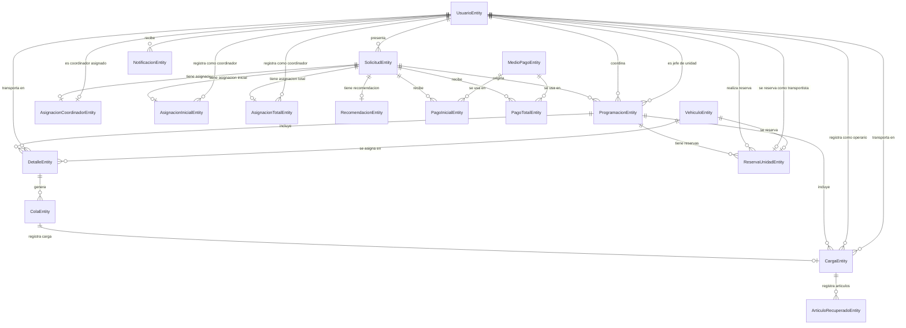

# DER — Relaciones

Diagrama de las relaciones JPA entre las 17 entidades del proyecto, sin atributos.
Las cardinalidades reflejan las claves foráneas, restricciones `unique` y nulabilidad
declaradas en las entidades.

`o|` indica cero o una relación; `o{` indica cero o muchas. Las relaciones
obligatorias desde las entidades dependientes están representadas por `||`.
